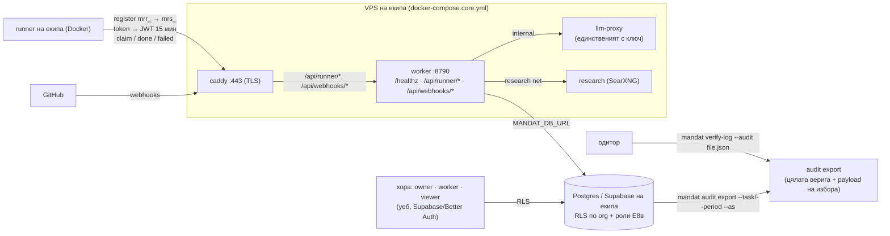

# Доклад E10 hosted — екип на hosted worker (v5 т. 6.1 + спайк 6.2) (26.11.2026)

## Статус: ГОТОВО (VPS и домейн чакат Симо; runsc — спайк [НП])
Клон `claude/phase-e10-hosted-7de353`. Решения D-700…D-706. Миграция `20261126000700_hosted_runners.sql`.

## Състоянието преди (картата)
- `deploy/docker-compose.core.yml` имаше caddy + worker + llm-proxy; Caddy водеше `/api/webhooks/*` към worker:8790, но
  worker-ът не пускаше HTTP сървър (`startWebhookServer` беше само експорт). Нямаше research sidecar и тайна за проксито.
- Екипи: org + `members` + ролите на E8в (`roles`, `has_cap`, `authorize`); RLS по org за изброени таблици. Нямаше обща
  проверка „друг екип не вижда нищо“ по всички таблици.
- Runner протокол: нямаше (демо промптът го изключваше); `task_steps` имат lease колони, но никой не ги ползва.
- Дневник: верига в Postgres, `verify-log --org`; нямаше одитен износ.
- Локално без вход (D-368), Better Auth за профили (D-495) — непроменени.

## Какво е направено
| Част | Къде |
| --- | --- |
| Compose: caddy (само 443), worker с hosted порт и healthcheck, llm-proxy (единственият с ключ), proxy-init (тайната за mdt_), research (SearXNG) | deploy/docker-compose.core.yml, deploy/Caddyfile (D-705) |
| Локален overlay: Postgres със shim + миграции, Caddy на https://localhost само на 127.0.0.1, worker `api` без Docker сокет | deploy/docker-compose.local.yml, deploy/local/initdb.sh |
| Hosted порт: `MANDAT_HOSTED=1`, `MANDAT_WORKER_ROLE=all|api`; webhooks → `sync_events` | apps/worker hosted-server.ts, hosted-env.ts; cli worker.ts (D-700) |
| Runner протокол: еднократна регистрация, `mrs_` тайна (само хеш), HS256 JWT ≤ 15 мин, отнемане веднага, rate limit | contract runner.ts; worker runner-api.ts, runner-jwt.ts, runner-client.ts (D-701) |
| Outbox през runner: lease, само своят екип и своите видове, 409 при изгубен lease; `HttpOutbox` = същият `OutboxStore` | миграция 700; pg-outbox.ts прескача жив lease (D-702) |
| Екипи: RLS проверка по всяка таблица/изглед с org_id; runner-ите и токените по роли | supabase/tests/teams_rls.test.sql, runners.test.sql (D-703) |
| Одитен износ `mandat audit export --task|--period [--as]` + `verify-log --audit` | contract audit.ts; ledger audit.ts; cli commands/audit.ts (D-704) |
| Спайк runsc/sbx, проба, документ за microVM при hosted | spikes/runsc-probe.mjs, docs/spikes/RUNSC.md (D-706) |
| Ръководство | docs/setup/hosted.md; чеклист редове 37–38 |

## Готово, когато
| Ред | Реален изход | |
| --- | --- | --- |
| Интеграционен тест с 2+ потребители и роли срещу локалния compose | `hosted-compose.docker.test.ts (5 tests) 83914ms` · `Tests 5 passed (5)`: само caddy и postgres публикувани на 127.0.0.1; ключ няма в worker-а; owner прави runner, worker/viewer/друг екип → 42501; runner на екип A минава ефект през HTTPS, редът на екип B остава pending; viewer вижда задачата, присъдата, дневника (3), runner-а; другият екип вижда 0 навсякъде | ✓ |
| `audit export` минава `verify-log` | в същия тест: `audit export --task … --as <worker>` → 0, `verify-log --audit` → „OK: chain intact … payloads and verdicts match“, viewer и друг екип → 4, `verify-log --org` → 0 | ✓ |
| pgTAP | `db tests ok (22 files, pglite)`; teams_rls 16/16, runners 22/22 | ✓ |
| `pnpm check` | виж долу | ✓ |
| VPS и домейн | docs/setup/hosted.md, чеклист 37 | чака Симо |
| runsc | пробата тук: runtimes `runc` само, runsc/sbx няма (macOS) — чеклист 38 | [НП] |

`pnpm check` (26.11.2026, довършено от друга сесия): build, lint, typecheck ✓; 2776 теста ✓, 5 таймаута при натоварване 26 (daemon, demo-offline-no-egress, job — не са пипани тук), същите 3 файла сами: 83/83; test:counts, `licenses ok`, `no-dotenv ok` ✓.

Бележки от проверката: първото пускане на `pnpm check` удари 20-секундния таймаут в `apps/worker/src/online/oracle.test.ts`
(не е пипан тук; сам минава 12/12 за 40 s) — под натоварване. Второто пускане мина всички тестове, но `licenses:check`
даде „Unknown“ за `@mandat/desktop`: в този worktree липсваше отделната инсталация на apps/desktop
(`pnpm --dir apps/desktop install --frozen-lockfile`, без нова зависимост). След нея — „licenses ok“.

## Какво не е направено (честно)
- Задачите на отдалечен runner (агент в пясъчника на runner-а, присъдата пак на сървъра) — протоколът носи само ефектите от
  outbox-а (`baseline`, `mcp_vet`, `harness_scan`). Командата `mandat runner` с истинските обработчици също не е направена.
- Worker-ът в compose: задачите и ресърчът търсят проксито на 127.0.0.1, а то е `llm-proxy:8787` [НП] — проверява се при
  деплоя (чеклист 37). Локалният тест върви с `MANDAT_WORKER_ROLE=api`.
- Уебът не е в compose (hosted уебът е Vercel/Supabase); страница за runner-ите и бутон за одитен износ в уеба няма —
  днес е през Supabase RPC/SQL и CLI.
- `MANDAT_SANDBOX_RUNTIME` не съществува в кода — само спайк.

## Схема

## Разход API: $0
