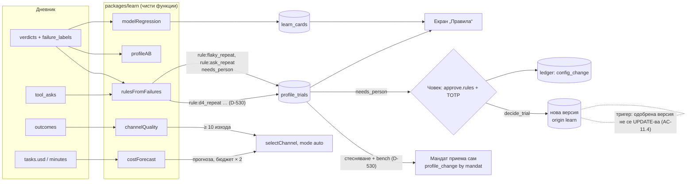

# E9д — учене (26.11.2026, клон claude/phase-e9e-learning-cc84bc)

Спецификация: т. 5.5; PRD 6.11 и AC-11.1–AC-11.4. Решения: D-640 (карта на припокриването), D-641 (правила с име),
D-642 (статистика), D-643 (одобрение и AC-11.4 в базата), D-644 (работникът), D-645 (уеб), D-646 (мерилото на AC-11.3).

## Карта на припокриването (D-640)
Еволюцията на профила (D-530/D-549/D-551/D-553) вече правеше „3 × провал от един клас → стесняване“. Не я дублирах:
- `packages/learn` (нов, чист) вика `rulesFromFailures` на packages/profile за осемте стари класа и само им дава име;
- новите правила (flaky, питания) живеят до тях;
- всички предложения за профила са в `profile_trials`. `harness_proposals` е за `.mandat.yml` (E3б) и не е пипан.

## Готово, когато
| Критерий | Статус | Доказателство |
| --- | --- | --- |
| AC-11.1: 3 × FAILED `D4:out_of_contract:infra/**` за 30 дни → „защити infra/**“ с произход `rule:d4_repeat` | ✓ unit + e2e | learn rules.test.ts; worker learn.test.ts (тик върху PGlite); web learn.test.ts (тик → изгледът на екрана, четен като viewer през RLS) |
| AC-11.2: Q се сменя след 10 OUTCOME-а и мести избора при `mode: auto` | ✓ unit | learn stats.test.ts; worker learn.test.ts: 9 лоши изхода оставят канал „a“, 10-ият го сменя на „b“ през `selectChannel` |
| AC-11.3: прогнозата е в ±50% за ≥ 70% след 20 задачи | измерен (D-646) | в USD: 0 платени задачи в локалната база (всичко е абонамент). В минути: 30/39 = 76,9% |
| AC-11.4: никое поле на профила не се сменя без `config_change` с одобрение | ✓ pgTAP | supabase/tests/learn.test.sql 22/22: тригерът пази всички полета на одобрена версия; `decide_trial` пише `config_change`; без одобрение няма нова версия |
| `pnpm check` | всички стъпки минават (повторно 26.11.2026 след последния комит): 2762 теста ✓ при 4 паралелни проверки на машината, 12 падания от натоварването (9 таймаута, 2 проверки, зависими от време) в daemon/job/oracle/ledger — същите 4 файла сами: 111/111; test:counts, licenses, no-dotenv ✓ | ✓ |

## Какво има
| Част | Къде | Тестове |
| --- | --- | --- |
| Договор: `LearnSource`, `sourceOfClass`, `LEARN_LIMITS`, `LearnCard`; промени `flaky_test`, `tool_allow`, `tool_deny`; `source` в манифеста | packages/contract/src/learn.ts, evolve.ts | learn.test.ts (6), evolve.test.ts |
| Прилагане и махане на новите промени | packages/profile/src/evolve.ts | evolve.test.ts (+2) |
| `rulesFromFailures` (8 стари класа с име + `flaky_repeat` + `ask_repeat`) | packages/learn/src/rules.ts | rules.test.ts (9) |
| `channelQuality`, `learnedQuality`, `costForecast`, `forecastAccuracy`, `profileAB`, `modelRegression` | packages/learn/src/stats.ts | stats.test.ts (7) |
| Чистота на пакета (само contract и profile) | packages/learn/src/purity.test.ts | 1 |
| Миграция: `source`/`needs_person`/`decided_by`, пазач на предложенията, `decide_trial`, пълен пазач на версиите, `learn_cards` | supabase/migrations/20261126000643_learn.sql | learn.test.sql (22) |
| Работник: тикът предлага с име; bench не пипа предложения за човек; Q и прогнозата в избора на канал; карти; A/B; мерило | apps/worker/src/online/learn.ts, evolve.ts, daemon.ts | learn.test.ts (7) |
| Уеб: правилото и „само ти“ на екрана; „Предупреждения за моделите“; решение с TOTP през API | apps/web/src/lib/server/evolve.ts, app/harness/page.tsx, api/profile-trials/[id]/decide | learn.test.ts (4) |

## Как работи

## Граници и какво не е направено
- D-647 (Симо 26.11.2026): новите правила вече не чакат човек. Всяко предложение минава bench вратата и се прилага само;
  flaky и allow искат и скрития набор без лъжливо VERIFIED и се връщат сами при повече провали или регресия на модела.
  На екрана има „Върни“. Само пробите на D-553 (махане на част) още чакат човек.
- Мандат продължава сам да приема стесненията на D-530 (одобрено от Симо на 16.11.2026). Тогава редът в дневника е
  `profile_change` с `by: mandat`, не `config_change`. Новите правила (flaky, allow/deny) винаги чакат човек.
- AC-11.1 и `protected_paths`: промяната е забрана за писане в слой C (`protect_path` на D-530), не ред в `protected_paths`
  на слой A. Слой A не може да се промени като „стесняване“ (D-641).
- Бутоните „Приеми/Откажи“ с TOTP още не са на страницата. Решението минава през `POST /api/profile-trials/:id/decide`,
  защото UI-то се прави наново.
- Прогнозата не се показва във формата за нова задача: формата се прави наново, а `forecastFor` е готова.
- A/B: задачите не пазят версията на профила си. Броят се към версията, одобрена, когато са създадени (D-644).
- Flaky се познава само по етикет на човек („verification“ или „infra“). Без етикет D1 регресията се брои за истинска.
- AC-11.3 в долари чака задачи с API ключ (M2). В минути методът минава 70% на тази история (D-646).
